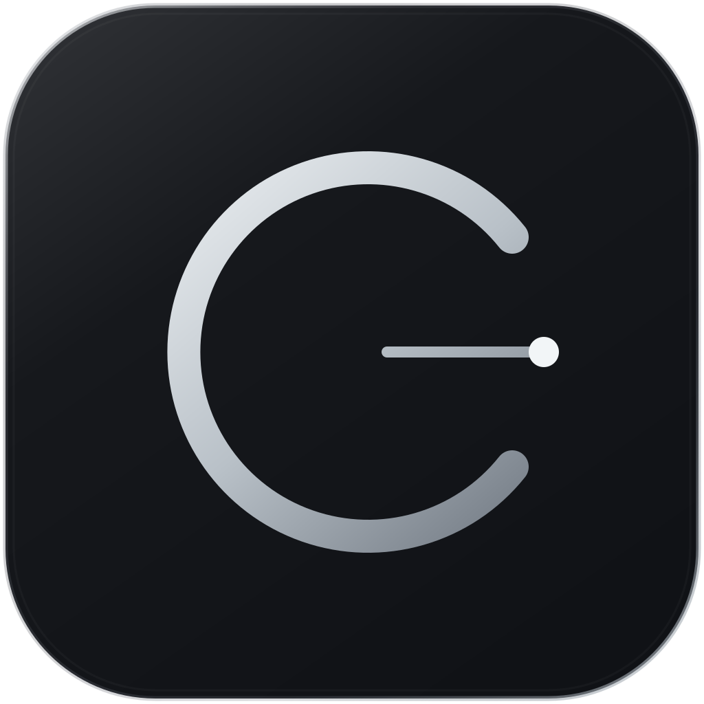

<p align="center">
  
</p>
<h1 align="center">Connect</h1>
<p align="center">A minimal VPN for Windows, with an independent Chrome extension.</p>
<p align="center"><a href="https://github.com/sanderstripa/connect/releases">Download for Windows</a></p>

Connect brings **Sudoku, Xray, AmneziaWG and experimental Mist** into a clean interface inspired by [sudoku-app](https://github.com/sanderstripa/sudoku-app). Montserrat typography, a quiet monochrome palette and light, dark or system themes keep the focus on your connection.

## Interface

The desktop controls follow [CONNECT UI System v1.0](docs/UI-SYSTEM-v1-IMPLEMENTATION.md) while preserving Connect's original light/dark palette, Montserrat, native window size and home layout. Theme and RU/EN preferences are inside Settings → Appearance. Shared controls provide contrasting primary actions, neutral secondary actions, keyboard focus rings and reduced-motion support. The settings entry uses the exact approved [gear #8](docs/assets/CONNECT-settings-08.svg), with no background tile.

## Windows

- Connect with one button and switch between saved protocol profiles.
- Route device traffic through TUN; the tray shows the application mark with grey lines when off and green lines when the core and tunnel are active.
- Import Sudoku links/subscriptions, VLESS, VMess, Trojan, a Mist client configuration or an AmneziaWG `.conf` profile.
- Preserve Xray xhttp parameters, including host, path, mode and extra, plus TLS/Reality settings. TCP, WebSocket and gRPC are also supported.
- Switch between Russian and English inside Settings → Appearance; your language is saved immediately.
- Keep profiles across updates and uninstallations. No server credentials are bundled.

Install **Connect-Setup.exe**, add your own connection, then select a saved profile through the connection card and connect. Closing the window keeps Connect in the tray; choosing Exit disconnects it. The interface runs normally, while its network helper requests Windows elevation when needed.

Sudoku ↔ Xray switching retains TUN, DNS and routes when server addresses are IPv4 and the local port is shared. The new core is checked with real HTTP traffic; failure restores the previous profile. Domain names, IPv6, different ports and Mist use a full restart.

Requires Windows 10/11 x64 and Microsoft Edge WebView2 Runtime. Desktop profiles are stored in `%APPDATA%\connect-app`.

## Updates and rollback

Open **Settings → Updates** to inspect installed versions, check each component or check everything at once. Connect, Xray, GeoIP/GeoSite, Sudoku, Mist and AmneziaWG have separate controls. Pre-release checking is enabled by default, including Xray pre-releases; the switch also lets you filter to stable releases.

Downloads require GitHub-published SHA-256 digests. Components are installed into immutable per-user slots in `%APPDATA%\connect-components`, shared by the desktop app and Chrome helper. The selected version takes effect on the next connection. Local rollback restores the previous files without downloading them again, including after restarting Connect. Component selections survive application updates.

Application updates launch the normal Windows installer after Connect closes. Installed copies cache their current installer for offline rollback. Older published versions can also be selected after a release check when no local backup exists. Disable the Connect extension on `chrome://extensions` while replacing the application, then reload and re-enable it after installation.

Xray and Sudoku are checked against their upstream releases. Geo includes both [GeoIP and GeoSite databases](https://github.com/Loyalsoldier/v2ray-rules-dat). Mist uses Connect release packages containing its compatible SOCKS adapter; ordinary upstream Mist executables are not interchangeable. Missing or unverifiable version information is shown as a file hash rather than a guessed release number.

## AmneziaWG

Click **Add connection**, then paste the contents of an AmneziaWG `.conf` file or choose **Open .conf**. This works in both Windows and Chrome. Complete self-hosted `vpn://` profiles and `awg://` Base64-encoded configurations are also accepted. Amnezia service/subscription keys that require their API are not supported: export a complete AmneziaWG `.conf` file instead. No server keys are bundled or sent to an enrollment service.

The pinned official AmneziaWG 3.1 userspace core preserves AWG 1/2/3 obfuscation fields (Jc/Jmin/Jmax, S1–S4, H1–H4, I1–I5 and AWG 3 options). The adapter supports one peer, TCP and UDP SOCKS traffic, and tunnel DNS. If DNS is absent, 1.1.1.1 is used through AWG, with no direct DNS fallback. AllowedIPs are respected. Imported shell hooks and unknown fields are rejected. Local ListenPort is allocated independently for desktop and Chrome.

Use **All traffic** with custom bypass rules disabled in Windows. This release does not implement AmneziaWG split routing. Chrome keeps its independent browser-only scope. Settings → Updates includes verified Connect-compatible AmneziaWG packages and local rollback; raw upstream tunnel executables cannot replace this SOCKS adapter.

Transport tests use isolated loopback AWG peers with real encryption, TCP, UDP and tunnel DNS for AWG 1, 2 and 3 parameter sets. No user VPN server, production route or system installation is changed by these tests. A live external AmneziaWG server has not been tested.

The desktop window remembers its last position across launches. If a monitor is removed, it returns to the visible desktop without changing its size.

## Chrome

**Your connections, directly in the popup.** Click **Add**, paste a link or client configuration, and let Connect detect the protocol. Each saved connection has a small switch. Turning on another connection turns the previous one off; turning off the active switch disconnects. There is no separate settings page. Switch between Russian and English or light and dark themes directly in the header; both preferences are remembered.

The extension and application share version 0.2.4. Closing the last normal or popup Chrome window disconnects the browser VPN, including when Chrome remains running in the background. A new browser session starts disconnected; saved connections and preferences remain available. Suspending/restarting the extension service worker during the same browser session preserves an explicitly enabled connection.

Chrome starts its own local helper, so the desktop window can remain closed. Browser profiles are stored independently in `%APPDATA%\connect-chrome`. The helper does not change Windows proxy settings, DNS or routes.

Enable the Chrome component in the installer. It opens `chrome://extensions` and copies the extension folder path. Enable **Developer mode**, choose **Load unpacked**, and select `C:\Program Files\Connect\ChromeExtension`. After updating, reload Connect once on that page. Existing profiles are preserved. Chrome Web Store distribution is not included.

The extension handles proxy-compatible Chrome traffic, rather than whole-device traffic. WebRTC UDP outside the proxy is disabled while enabled. If the helper or connection fails, the proxy remains in place to prevent a silent return to direct browsing; Connect retries, or you can explicitly disconnect. All protocols require the installed native helper.

## Validation and current limits

Automated checks cover Windows core and installer tests, link import, browser isolation, extension lifecycle and UI behavior. Local integration tests pass real HTTP through Xray/xhttp and Sudoku, exercise switching and rollback, and verify that Windows proxy settings remain unchanged. The Mist SOCKS adapter has TCP/UDP tests; an external Mist Edge connection and TUN operation in the user's network still need separate validation.

- Mist is experimental. Its sources are pinned to revision `d4e7dacf22f9c3f4c5d762883544c102da0c6b49` of `mist-hardening-32`.
- Windows split tunneling is available for Sudoku and Xray. Mist and AmneziaWG use all-traffic mode; Chrome currently has no configurable exclusions.
- One Chrome profile can be active per Windows user. Protocol cores update with the application.
- Executables are unsigned. Local test timings do not guarantee remote connection speed.

## Build

Windows x64, Go 1.27.0+, Node.js 24+, Git and internet access are required.

```powershell
./scripts/build-windows.ps1
node ./scripts/test-extension.mjs
node ./scripts/test-native.mjs
cd frontend
npx playwright install chromium
npm test
cd ..
./scripts/build-installer.ps1 -SkipApp
```

Outputs: `build/bin/Connect.exe`, `Connect-Setup.exe` `Connect-Chrome.zip` and the updater asset `Connect-Mist-windows-amd64.zip`.

Xray 26.3.27 is downloaded from its official release with archive SHA-256 verification. Mist builds from included sources; Sudoku 0.5.1 and HEV 2.17.1 are packaged by the build scripts. See [BUILD-PROVENANCE.md](BUILD-PROVENANCE.md), [THIRD_PARTY.md](THIRD_PARTY.md) and [LICENSE](LICENSE) for provenance and licensing. The original project's GPL-3.0-or-later terms and notices are retained.

The signal-and-peak identity is maintained in [connect.svg](build/branding/connect.svg). All application, installer, extension, tray and platform icons are generated from this vector source during the Windows build.
